# Kégué Billetterie 3D

Billetterie 3D pour un match au **Stade de Kégué** (Lomé, Togo). On survole le stade, on voit le prix et les places restantes de chaque tribune, la caméra plonge dans le bloc choisi, on regarde le terrain **depuis son propre siège** avant de payer, puis on règle par **T-Money ou Flooz** et on reçoit un e-billet avec QR code.

**Démo en ligne : https://kegue-tickets-3d.vercel.app**
Mode démonstration automatique (pour les vidéos) : https://kegue-tickets-3d.vercel.app/?demo=1

> Concept indépendant, non officiel. Aucun lien avec la Fédération togolaise de football ni avec la gestion du stade. Le match, les prix et les disponibilités sont fictifs, et aucun paiement réel n'est effectué.

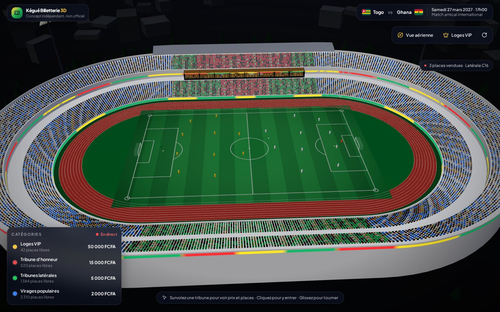

Vidéo du parcours complet (16:9) : [video/kegue-billetterie-3d-1920x1080-web.mp4](video/kegue-billetterie-3d-1920x1080-web.mp4)

## ⭐ Star & Fork

Si le projet te plaît, laisse une **⭐ Star** et fais un **Fork** pour l'adapter à ton stade, ton club ou ton événement. Ça m'aide énormément à continuer à partager ce genre de projets.

## Ce que fait l'application

| | |
|---|---|
| **Vue aérienne 3D** | Le stade entier, librement orientable (glisser pour tourner, molette ou pincement pour zoomer). |
| **Survol des tribunes** | Prix, catégorie et places restantes de chaque bloc, mis à jour en direct (ventes simulées). |
| **Vol vers le bloc** | Un clic sur une tribune et la caméra s'y rend en douceur. Le plan des sièges s'ouvre. |
| **Vue depuis le siège** | La caméra se place à hauteur des yeux sur le siège choisi. On peut regarder autour avant de réserver. |
| **Loges VIP** | Huit loges vitrées sous la tribune d'honneur, accessibles en un clic. |
| **Paiement Mobile Money** | Récapitulatif, choix du nombre de places côte à côte, T-Money ou Flooz, confirmation sur téléphone (simulée). |
| **E-billet** | Billet avec bloc, rang, siège, porte d'accès et QR code, téléchargeable en image. |

Catégories de la démo : Loges VIP (50 000 FCFA), Tribune d'honneur (15 000 FCFA), Tribunes latérales (5 000 FCFA), Virages populaires (2 000 FCFA).

## Captures

### Ordinateur

| Survol d'une tribune | Choix du siège |
|---|---|
| 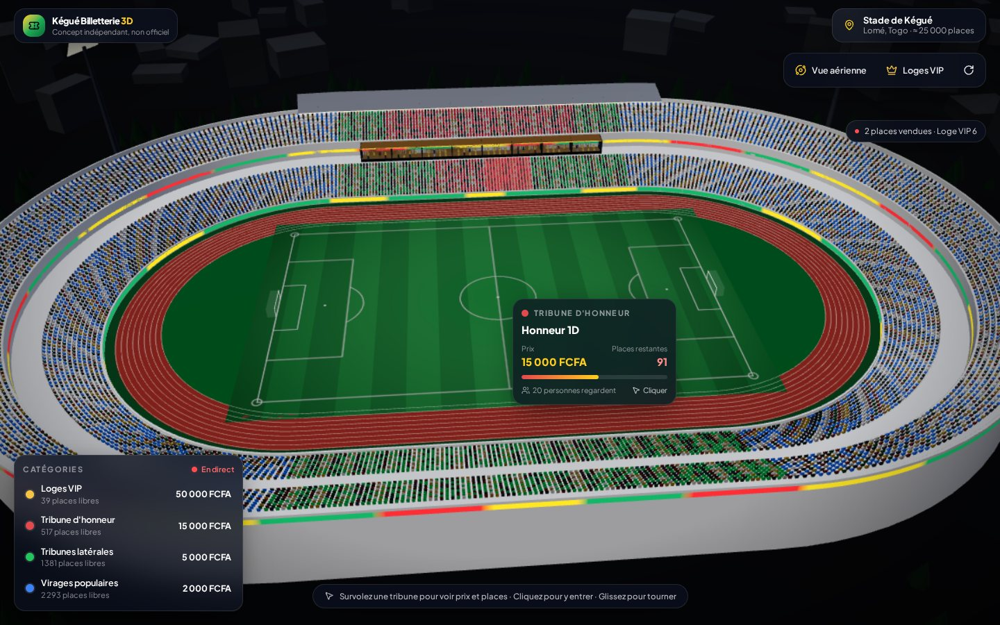 | 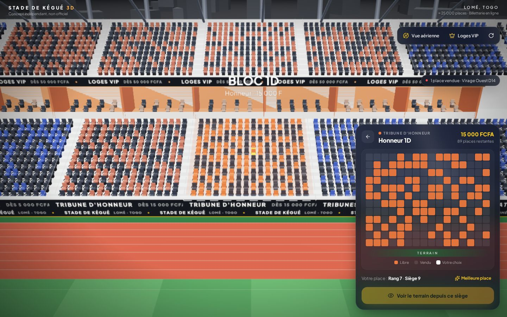 |
| **Vue depuis le siège** | **Loges VIP** |
| 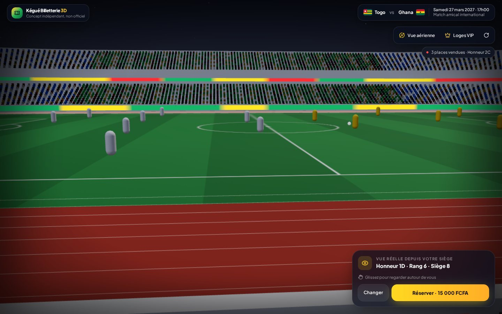 | 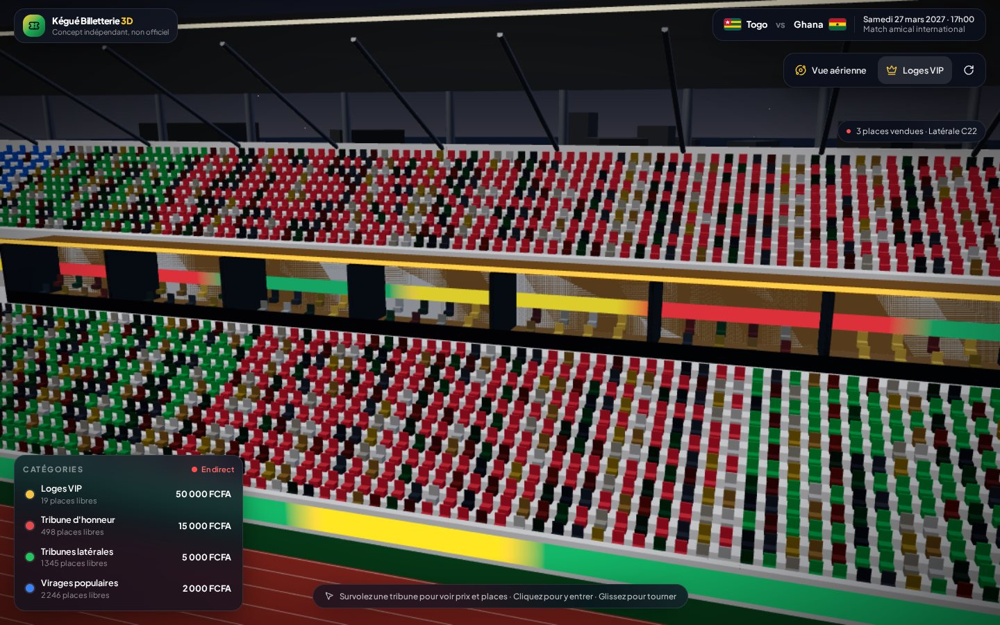 |
| **Paiement T-Money / Flooz** | **E-billet avec QR code** |
| 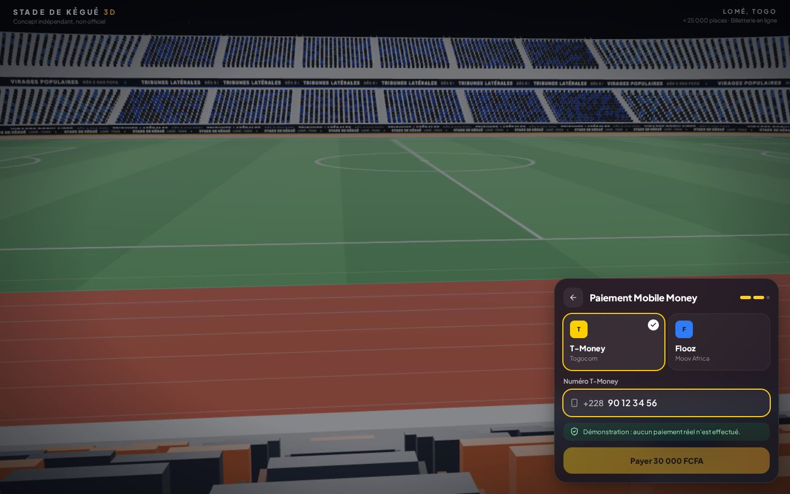 | 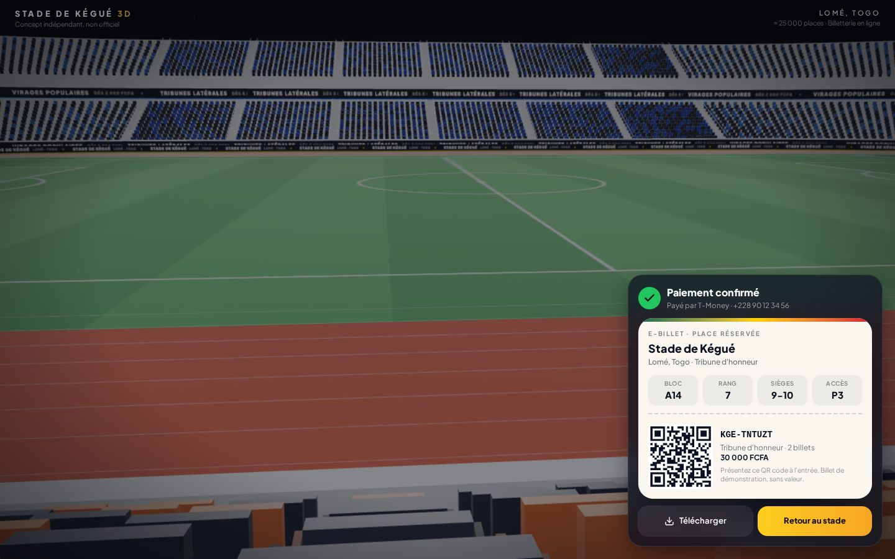 |

### Mobile (390 × 844)

| Stade | Plan du bloc | Vue du siège | Paiement | E-billet |
|---|---|---|---|---|
| 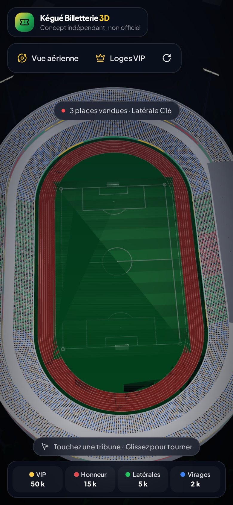 | 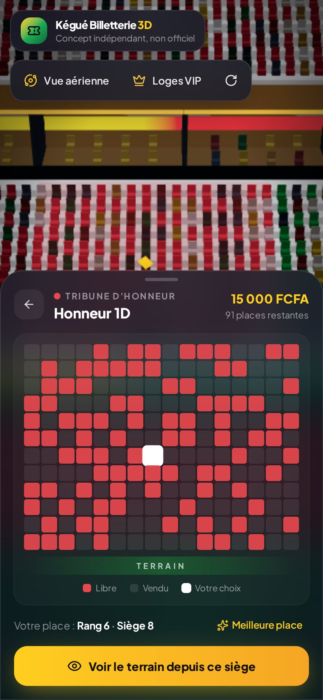 | 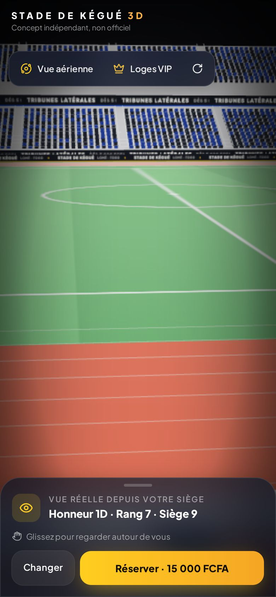 | 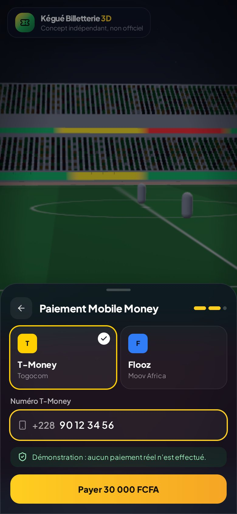 | 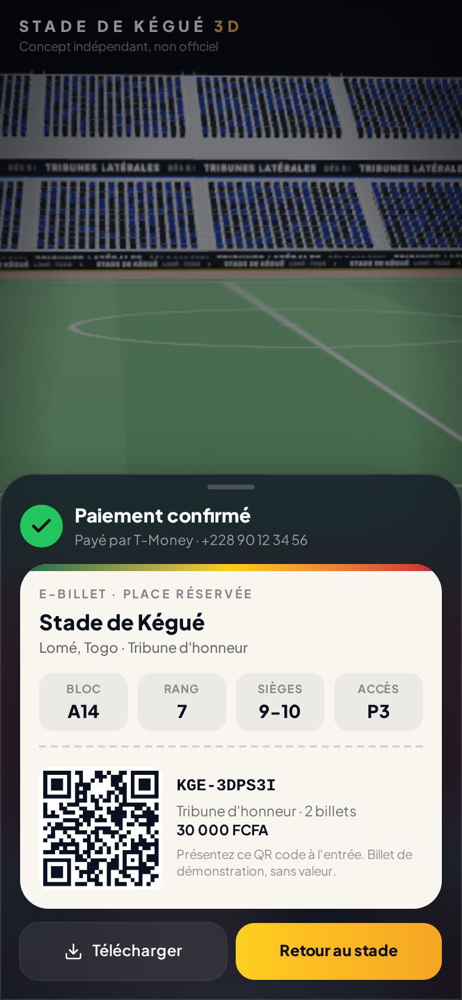 |

## Le stade, modélisé en code

Aucun fichier Blender ni modèle lourd à télécharger : tout le stade est généré dans le navigateur.

- Forme ovale d'un stade avec piste d'athlétisme (deux lignes droites et deux virages), pelouse aux dimensions 105 × 68 m avec son marquage dessiné sur un canvas.
- Deux anneaux de gradins tout autour, une bande de loges VIP vitrées et une toiture sur la tribune principale, des bandeaux LED aux couleurs du Togo, quatre pylônes d'éclairage.
- Plus de 11 000 sièges individuels dans **un seul `InstancedMesh`** (un seul appel de dessin). La couleur de chaque siège indique sa catégorie, s'il est libre ou déjà vendu.
- Zones invisibles par bloc pour le survol et le clic, sans lancer de rayons sur les 11 000 sièges.

Repères réels utilisés : le Stade de Kégué est un stade multifonction inauguré en 2000, avec piste d'athlétisme, d'une capacité d'environ 25 000 places après les travaux de mise aux normes. La disposition détaillée (blocs, loges, portes) est une interprétation libre.

## Performance et mobile

- La scène 3D est chargée à part (`React.lazy`) : l'interface s'affiche tout de suite.
- Résolution adaptative (`PerformanceMonitor`) : la densité de pixels baisse si l'appareil peine.
- Pas d'ombres temps réel ni de post-traitement, des matériaux simples et une géométrie fusionnée.
- `100dvh`, `viewport-fit=cover` et marges `safe-area` : rien n'est caché sous la barre de Safari sur iPhone. Sur mobile, les étapes s'affichent dans une feuille du bas qui défile.

## Stack

React 19 · TypeScript · Vite · Three.js avec React Three Fiber et drei (CameraControls) · Tailwind CSS 4 · Motion · zustand · qrcode · lucide-react.

## Lancer en local

```bash
npm install
npm run dev
```

Build de production : `npm run build` puis `npm run preview`.

## Mode démonstration

`?demo=1` rejoue tout le parcours automatiquement : survol des tribunes, rotation du stade, visite des loges, vol vers un bloc, choix du siège, vue depuis le siège, paiement T-Money et e-billet. Le script `scripts/record.py` s'en sert pour enregistrer une vidéo image par image (avec `?demo=1&capture=1`, une horloge virtuelle rend chaque image sans saccade).

## Crédits

Concept original : **Preston Odep**, dont la billetterie 3D du Raila Odinga Stadium a inspiré ce projet. Cette version adapte l'idée au Stade de Kégué, avec paiement Mobile Money.

Réalisé par [Donchaminade](https://github.com/Donchaminade). Licence MIT.
